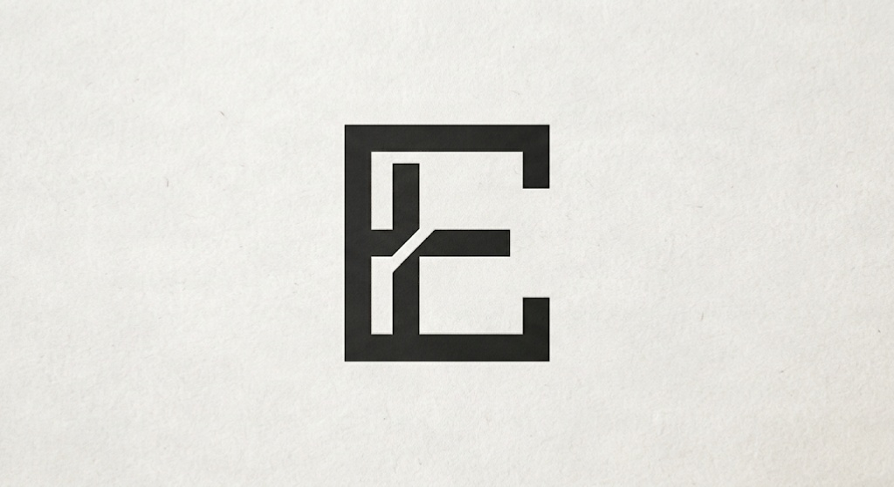

# euphoria-re

A fast, scriptable disassembly workbench, currently in beta. Expect bugs and breaking changes. It parses PE, ELF, and Mach-O files, finds functions from the entry point, symbols, exports, and a prologue scan, and shows 32-bit and 64-bit x86 disassembly, control flow graphs, references, and strings in a desktop app. It also reports entropy, identifies common packers, decodes Base64 strings, finds single-byte XOR text, searches byte patterns with wildcards, stages edits against a saved copy, explains SQL files without running them, reads Android APKs down to Dalvik bytecode, dumps everything it knows about a file into one zip, turns x86 and x64 routines into C-like pseudocode, and debugs Windows programs with breakpoints, stepping, and process control. Function detection is still rough, and the decompiler is young: it won't match a mature commercial one on large optimized programs. See [PLAN.md](PLAN.md) for the roadmap.

Everything runs locally unless you tell Aero, the networking library, to contact a domain. Euphoria asks first, for each domain.

Only analyze binaries you own or have permission to inspect, and only scan or send requests to systems you own or have permission to test.

## Build

You need Rust, CMake, Ninja, NASM, and a GCC or Clang toolchain. On Windows that means the `x86_64-pc-windows-gnu` Rust toolchain with MinGW, since the native build has not been tested with MSVC.

```bash
cargo build --release
```

## Use

```bash
cargo run -p euphoria-cli -- analyze path/to/binary --save out.euph
```

`.euph` datasets hold the program and your saved work, compressed, and reopen like any other file.

```bash
cargo run -p euphoria-cli -- functions path/to/binary --json
```

```bash
cargo run -p euphoria-cli -- graph path/to/binary main
```

```bash
cargo run -p euphoria-cli -- inspect path/to/binary
```

```bash
cargo run -p euphoria-cli -- overview path/to/binary --json
```

`overview` prints one canonical summary of the binary: identity and hashes, sections with entropy,
routine coverage, imports, the largest routines, detections, and structural findings. Every list has
a fixed order, so two runs over the same bytes produce identical output, which makes it usable in
diffs and automation.

```bash
cargo run -p euphoria-cli -- xor path/to/binary --json
```

```bash
cargo run -p euphoria-cli -- sql path/to/dump.sql
```

```bash
cargo run -p euphoria-cli -- apk path/to/app.apk
```

```bash
cargo run -p euphoria-cli -- dump path/to/binary_or_apk -o dump.zip
```

```bash
cargo run -p euphoria-cli -- sample --out demo.apk
```

`sample` writes the bundled synthetic APK again, which is useful after changing the `apk` crate's
sample builders.

```bash
cargo run -p euphoria-cli -- links path/to/binary
```

```bash
cargo run -p euphoria-cli -- redirect path/to/binary https://host/path -o patched.bin
```

`redirect` rewrites a URL in the binary to point at `127.0.0.1` and writes a patched copy, for pointing a sample at the local emulator. The input file is only read. In the Networking tab, right-click a link and choose "Patch to local emulator" to do the same, then save the patched copy.

```bash
cargo run -p euphoria-cli -- aero scan example.com --i-have-permission
```

```bash
cargo run -p euphoria-cli -- aero send https://example.com/ --i-have-permission
```

```bash
cargo run -p euphoria-ui -- path/to/binary
```

## First run, the tour, and bundled samples

The first time the app starts without a file argument it shows a welcome window. **Take the quick tour**
walks through the logo menu, opening files, the listing, the debugger, and the Advanced switch with
Next, Back, and Skip buttons and a highlight around each control. Afterwards it does not appear again;
open it from the logo menu with **Quick tour**. The answer is remembered in `guide.json` next to
`config.json`.

The same windows offer three samples from `samples/`, and release archives place that folder next to
`euphoria.exe`:

| File | Use it to try |
| --- | --- |
| `hello.exe` | Listing, graph, decompiler, debugger, and breakpoints on a plain program. |
| `encoded.exe` | The XOR scanner and a decoder loop in the decompiler. It prints its decoded text and exits. |
| `demo.apk` | Manifest, DEX, native library, and protector sections of the APK analyzer. |

Euphoria looks for the folder in `$EUPHORIA_SAMPLES`, then `samples/` beside the executable, then
`samples/` in the current directory. [samples/README.md](samples/README.md) explains how to rebuild
them with `scripts/make-samples.sh`.

## Plugin marketplace and public database

The Marketplace section of the Plugins tab lists what's in [euphoria-plugins](https://github.com/JoeyKoch1/euphoria-plugins). A plugin installs switched off, only after its contents match the hash in the list, and you turn it on yourself under Local.

You can also use `eu plugin market` to list them and `eu plugin install <id>` to install one.

To publish one, add your `.lua` file to `plugins/` in that repo with a lowercase name, then run this in your checkout to refresh the list:

```bash
eu plugin index path/to/euphoria-plugins
```

The File tab can check [euphoria-db](https://github.com/JoeyKoch1/euphoria-db) for routine names other people shared about the same file. Lookups are off until you ask for one, and each one tells GitHub the file's SHA-256. The file itself never leaves your computer. Sharing saves a small JSON file with routine addresses, sizes and names, which you upload yourself. Dumps live at `dumps/<first two hash characters>/<sha256>.json`.

## Configuration

Everything has a working default. To point Euphoria at a fork or a mirror, create `config.json` in the Euphoria settings folder, which is `%APPDATA%\Euphoria` on Windows and `~/.config/Euphoria` elsewhere. Any field can be left out.

```json
{
  "plugin_repo": "JoeyKoch1/euphoria-plugins",
  "database_repo": "JoeyKoch1/euphoria-db",
  "branch": "main",
  "raw_base": "https://raw.githubusercontent.com",
  "web_base": "https://github.com",
  "automatic_lookups": false
}
```

## Android runtime

The APK tab has a **Run APK** button and a **Runtime** section. Euphoria boots a disposable Android Virtual Device, installs the APK that is currently loaded, launches its launcher activity, and shows the device through scrcpy or the emulator's own window. Stop, Restart, Reset, Stop app, Relaunch app, Show display, a live logcat panel, and a network capture console are in the same section. Reset boots again after wiping the AVD's data.

Once Android has booted, Euphoria sets the home wallpaper to the Euphoria logo (the bundled `logo.jpg`). This is cosmetic and best effort: if Android's wallpaper service refuses the image, the runtime says so and the APK still starts.

The **Network** console lists HTTP exchanges and HTTPS tunnel destinations made by apps that honour Android's system proxy. Euphoria runs a local HTTP proxy, points the AVD's `http_proxy` setting at it through the emulator's `10.0.2.2` host alias, and shows method, host, path, status, byte counts, timing, and a text preview of HTTP responses. HTTPS is not decrypted: the console shows the destination and byte counts of the encrypted TLS tunnel. Apps that ignore the system proxy, or pin certificates, will not appear. The proxy is removed when the emulator stops, and both wallpaper and capture can be turned off in Settings.

Euphoria does not ship the Android tools inside the app. If they are missing, Run APK and the Runtime section show **Set up automatically**, which asks for confirmation before downloading anything. Setup uses only the official sources: Google's SDK repository at `dl.google.com` and the official scrcpy releases on GitHub. It installs only what is missing:

- the Android command-line tools, `platform-tools` (adb), and the emulator;
- a `google_apis` system image and a disposable AVD named `Euphoria_API_34`;
- scrcpy on Windows. Other platforms use the emulator window, or scrcpy from a package manager.

Installing needs Java 17 or newer. Euphoria looks in `JAVA_HOME`, `PATH`, and Android Studio's bundled JDK, and stops with instructions if none is found. Checksums published by Google (SHA-1) and GitHub (SHA-256) are verified when available. The managed SDK goes in `android-sdk` inside the Euphoria settings folder unless an SDK path is configured.

You can also install everything yourself:

```bash
sdkmanager "platform-tools" "emulator" "system-images;android-34;google_apis;x86_64"
avdmanager create avd -n euphoria -k "system-images;android-34;google_apis;x86_64" -d pixel_5
```

Cancel during setup stops the download and removes the partial file; components that were already installed stay. No download starts without pressing Install.

Enable WHPX on Windows, KVM on Linux, or Hypervisor.framework on macOS. Euphoria runs `emulator -accel-check` and refuses to start unless acceleration is available, unless **Allow software emulation** is enabled in Settings; software emulation is very slow.

Settings live in `android.json` next to `config.json` in the Euphoria settings folder. Empty tool paths make Euphoria search `ANDROID_SDK_ROOT`, `ANDROID_HOME`, common SDK locations, and `PATH`. The default display is 1280x720 at up to 60 FPS with H.264 in scrcpy. FPS is a request, not a guarantee. If scrcpy is missing, Euphoria shows the emulator window instead; otherwise the emulator runs headless and scrcpy forwards keyboard and mouse input.

Only the bytes of the loaded APK are installed: Euphoria stages them in a temporary folder and verifies that they still match the analyzed SHA-256. Installation and launch errors, device details, and logcat stay in Euphoria; stopping the runtime does not close the app.

Use a disposable AVD with no personal accounts. Reset wipes its data. Only run APKs you own or are allowed to inspect.

## Advanced tab

The Advanced tab holds file-level tools. **Advanced Analysis** shows or hides the APK, SQL, Networking, and XOR tabs; opening an APK or SQL file turns it on.

- **Recon** groups risky imports by category, flags packed executable sections and a missing entry routine, and lists the largest routines for a quick jump.
- **Byte search** accepts patterns like `48 8B ?? 89` or `488B??89`, where `??` matches any byte, across all sections, executable sections, or just the routine under the cursor.
- **Patch studio** stages text replacements at an address or routine. A blank length measures a null-terminated string. Edits are written to a new copy only; the original file is never changed, shorter text is null-padded, and overlapping edits are refused.
- **Structure hints** decompiles the routine under the cursor and groups the fields it reads and writes through each base pointer, with type, read and write counts.

The **Euphoria Hypervisor** start button is also here. It currently checks for AMD hardware and then reports that the hypervisor is not built.

## Attached processes and `.euphp` patch files

Click the Euphoria logo in the toolbar to open its menu. **Attach to process...** lists running processes and opens a handle to the one you pick. Attaching does not suspend the program and does not install a debugger; Euphoria reads its memory and asks Windows for write access, falling back to read-only when that is denied. Detach, or close Euphoria, and the handle is released.

While attached, the File tab shows the process path, thread and handle counts, how much memory is committed, private, image and executable, the loaded modules, and a memory map with each region's protection and kind. Click a `.dll` to look for other running processes that currently have a module with the same name loaded; the lookup runs in the background.

The same section can suspend, resume, or stop the process. Stop asks first, because it terminates the process and discards staged edits; suspend and resume act on every thread and report how many changed. F3, Shift+F3, and Ctrl+F9 do the same from the keyboard.

Attaching also loads the process's main module into the analyzer. Euphoria reads the module from disk, moves its preferred image base to where the process actually mapped it, and copies each section's mapped bytes out of the process. The Listing, Graph, and Decompiler then show the code at the addresses the process uses, including any changes it made to itself after loading. The Debugger tab switches to the live view while an attachment is open: process state, a thread list with captured instruction pointers, registers, the stack, live code around the selected thread, a module list, and a hex memory reader. Euphoria captures registers once when the live module finishes loading; **Capture registers** repeats it on demand, pausing each thread just long enough to copy its context and then resuming it. Suspend first for a snapshot that does not drift. **Decompile at IP** opens the routine at the instruction pointer. Double-click a module under **Modules** to inspect that DLL or EXE the same way, at its own live base. Detaching, stopping the process, or the process exiting clears the live module and returns to a normal file view.

The **Patch File** tab appears while attached. Stage byte edits at `module.dll+0x1234`, a bare module name, or an absolute hex address. Euphoria reads the bytes at the target first, refuses edits that overlap, exceed 64 KiB, or already match, and keeps the original bytes. **Apply** and **Restore** ask for confirmation and write through the process handle; every other action only reads. **Save** writes a `.euphp` file.

`.euphp` is a versioned patch file: the magic header `EUPHP\x01` followed by JSON. Each entry records the module name, the offset from that module's base, the original and patched bytes, and a note, along with the target name, path, pid and creation time. Because entries are module-relative, they stay valid across restarts and address randomization. Euphoria writes and reads this format; applying a saved patch to a process is still a manual step.

## Decompiler

Open the Decompiler tab, or press F5, to see the routine under the cursor. It lifts machine code to an intermediate form, rebuilds variables with SSA, recovers stack slots, arguments and return values, and structures the result into if, while, for, do and switch. It also undoes the multiply-and-shift tricks compilers use for most constant division.

`decompiler/check/check.py` compiles sample C with gcc, decompiles the machine code, compiles that pseudocode, and compares what both versions return.

What it doesn't do yet: recover full struct layouts (the Advanced tab lists the fields it can see through pointers), lift vectorized code (it shows up as an `__asm__` line), or decompile ARM64.

### Local AI assist

The optional **Assist** panel under the Decompiler header asks a local, OpenAI-compatible endpoint to explain the routine on screen. It ships off. Nothing is sent automatically: pressing **Explain this routine** makes one request, and that request contains only the pseudocode of the routine you are looking at. The default endpoint is Ollama on this machine (`http://127.0.0.1:11434/v1/chat/completions`); set a model name to match what you have installed. Choosing an endpoint that is not on this machine shows a warning, because then the code leaves your computer. The endpoint and model are saved in `assist.json` in the Euphoria settings folder.

## Debugger

The buttons under the Listing header set breakpoints and drive a real run of the program. Euphoria asks before the first run of each file, because the program really executes. Only run what you own or are allowed to inspect, and use a virtual machine for anything you don't trust.

| Key | Action |
|---|---|
| F2, or double-click a line | Set or remove a breakpoint |
| F3 | Pause the running program, or suspend an attached process |
| Shift+F3 | Resume a paused program, or resume an attached process |
| F9 | Run or continue |
| Ctrl+F9 | Stop the launched program, or terminate the attached process |
| F7 | Step into |
| F8 | Step over |
| Shift+F8 | Step out |
| F4 | Run to the cursor |
| F5 | Toggle the decompiler for the cursor |
| Ctrl+M | Bookmark the cursor address |

Right-click a line to patch it: write NOPs over the current instruction, replace it with `ret`,
open a jump editor that encodes a relative jump with the remaining bytes padded to NOPs, or enter
exact bytes. The same menu sets breakpoints, copies the address or bytes, follows the branch target,
and adds a bookmark. Quick patches require the program to be paused. Lines whose bytes were written
are dimmed and marked `patched` until the program exits or restarts, because the listing still shows
the file on disk. Routines in the Routines tab offer the same menu, plus **Force return** to paste a
`ret` at the routine entry.

The Debugger tab shows registers, flags, the stack, live code, memory, loaded modules, threads, a
memory map with protection and kind, bookmarks, breakpoints, and a log. Bookmarks are gold in the
listing and listed in their own pane. It handles 32-bit and 64-bit programs
on 64-bit Windows and has software breakpoints only.

To inspect a program that is already running, use the logo menu to attach. The Debugger tab then
shows that process instead of a launched one: attach reads the main module at its live base, and
**Capture registers** copies each thread's instruction pointer, registers, and stack. Launch, step,
and breakpoint controls are hidden for a live module, because they would start a separate copy from
disk. Attaching does not suspend the program by default, every memory path starts read-only, and
F3, Shift+F3, and Ctrl+F9 suspend, resume, or terminate the process once you mean them to.

## Layout

| Folder | Language | Owns |
|---|---|---|
| `capi` | Rust | The ABI, defined once in `src/abi.rs`. `euphoria.h` is generated from it, and the build compiles the native code. |
| `core` | C++20 | Analysis |
| `db` | C | Storage |
| `simd` | NASM and C | Byte and pattern scanners |
| `formats` | Rust | File parsers |
| `engine` | Rust | The one API that the CLI and UI share, including the instruction listing, `.euph` datasets, and the `.euphp` patch file format |
| `sql` | Rust | SQL script and SQLite inspection |
| `aero` | Rust | HTTP client, subdomain discovery, response capture, and the local emulator |
| `apk` | Rust | APK reader: manifest, DEX classes, and Dalvik bytecode |
| `android` | Rust | Android emulator, ADB, scrcpy, logcat, network capture proxy, wallpaper, and the consent-first SDK installer |
| `decompiler` | Rust | Machine code to C-like pseudocode |
| `debugger` | Rust | Runs and controls Windows programs, and attaches to running processes for inspection |
| `community` | Rust | Settings file, plugin marketplace, and public database client |
| `dump` | Rust | Parallel dump of everything about a file into one zip |
| `plugins` | Rust and Lua | The Lua plugin host, its API, and example plugins. See [plugins/README.md](plugins/README.md). |
| `samples` | C and binaries | Safe files for the tour and manual testing. See [samples/README.md](samples/README.md). |
| `hypervisor` | None yet | Reserved for the Euphoria Hypervisor |
| `cli` | Rust | The `eu` command |
| `ui` | Rust | The `euphoria` desktop app |

## Test

```bash
cargo test --workspace
```

The scanner test compares the assembly and C versions:

```bash
cmake -S . -B build -G Ninja
```

```bash
cmake --build build --target scan_test
```

```bash
ctest --test-dir build --output-on-failure
```
**Disclaimer**
While building this project, I'm using AI because why not take advantage of a tool that makes development easier and helps me make progress faster? It's free, it's useful, and it helps me get things done. So there's really no reason to complain.

## Antivirus detections

Euphoria opens process handles, reads and writes memory, and launches programs under a debugger. Those
are the same Windows APIs that many trojans use, so unsigned builds sometimes trip behaviour
heuristics. Defender has labelled this project's own unsigned builds `Trojan:Win32/Cloxer` and
`Trojan:Win32/Sabsik.FL.A!ml`. The `!ml` suffix marks a machine-learning verdict rather than a match
for a known sample, and those family names are generic labels for process manipulation. A file under
`target/release/deps/euphoria-<hash>.exe` is the freshly linked local binary, so a quarantine there is
the same false positive as one on a downloaded release. Euphoria is not trying to evade security
products, and the source is here to read. If a build is quarantined:

1. Check where the binary came from and compare its SHA-256 with the release page.
2. Submit it to Microsoft as a false positive, or build it yourself from this repository.
3. If you distribute builds, sign them with an Authenticode certificate.
4. If you built it yourself and trust the source tree, a scoped exclusion for the workspace `target`
   directory keeps incremental builds working. Never exclude the whole project, and never exclude a
   file you did not build.

Don't add an antivirus exclusion for a file you have not verified.

## License

Euphoria is source-available under the [PolyForm Noncommercial License 1.0.0](LICENSE). It isn't open source in the strict sense.

You can read, build, change and share it for free for personal use, study, hobby projects, and at schools, charities and public research groups. Commercial use needs a paid license, so open an issue on this repo if your company wants one.

By sending a pull request, you agree that your contribution can be used under this license and under paid commercial licenses for Euphoria.

Third-party packages keep their own licenses, listed in [THIRD_PARTY.md](THIRD_PARTY.md).
